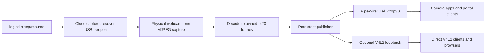

# Linux Webcam Bridge

Keep a troublesome USB webcam usable across app restarts, camera switching,
USB reconnection, suspend and hibernate by sharing one persistent capture.

**Validated hardware: Jieli Technology USB PHY 2.0 (`1224:2a25`), 1280×720 at
30 FPS.** The approach may help other cameras with similar stop/start failures,
but this release includes device-specific capture settings, a WirePlumber rule
and a Jieli-only reset helper. Other devices are **unverified and require a
reviewed port**. The project is a userspace workaround; the kernel UVC driver
and camera firmware remain unchanged.

## The problem

On the reference camera, a first MJPEG stream after USB reset works. Stopping
and reopening it leaves applications with black video. An intact USB capture
showed that the second session delivered no complete JPEG frames even though
UVC negotiation succeeded. Resetting the device restored the first stream.

A [2020 Linux media report for the same USB ID](https://www.spinics.net/lists/linux-media/msg180041.html)
describes a similar failure requiring reconnection. Similar symptoms alone do
not establish that another camera has the same underlying fault.

## What this project does

- Keeps physical capture running while clients come and go.
- Publishes a shared PipeWire camera; optionally feeds `/dev/video10`.
- Includes an isolated PipeWire 1.6.8 GStreamer buffer-pool patch that prevents
  a separate publisher stall when consumers retain or release buffers.
- Keeps the publisher present through disconnect and system sleep, using a
  neutral **Camera unavailable / Reconnecting** frame after 250 ms without
  input. It does not replay the last camera image.
- Coordinates capture teardown with logind's bounded delay inhibitor and
  recovers after resume, waiting for USB re-enumeration instead of giving up.
- Leaves the integrated camera available. Hides only the raw Jieli and the
  optional duplicate loopback from WirePlumber's camera list.

**Privacy and tradeoffs:** the physical camera remains active, and its LED may
stay on, whenever the user service is running and the camera is connected.
Video is decoded in memory and offered to local camera clients. The bridge
does not save frames or transmit them over the network. Continuous decoding
costs CPU/power; raw I420 is about 41 MB/s at 720p30 before copies. USB recovery
briefly interrupts the webcam's composite microphone too.

## Rust implementation

The runtime and installers in this repository are Rust:

- `crates/jieli-bridge` — supervisor, capture, logind and recovery;
- `crates/jieli-publisher` — GStreamer/PipeWire publisher and native V4L2 writer;
- `crates/jieli-usb` — reproducible privileged reset helper;
- `crates/jieli-install` — user-file installer with manifest and backups.

The shell wrappers handle the pinned upstream C plugin build and the
reproducible helper build. No interpreted runtime is required. The Rust
service keeps the live node name `jieli_720p30`, description `Jieli 720p30`,
PT placeholder and `Jieli` fallback for `video10`.

## Start here

1. Check the [supported environment and installation steps](docs/installation.md).
2. Review [privileges and security](docs/security.md), especially before
   installing the optional root reset helper or kernel loopback module.
3. Use the [validation guide](docs/validation.md) to check your own device.

For failures, see [troubleshooting](docs/troubleshooting.md) and
[rollback](docs/rollback.md).

The reference system used Pop!_OS based on Ubuntu 24.04, GNOME Wayland,
PipeWire 1.6.8, WirePlumber 0.5.12, GStreamer 1.24.2 and Rust 1.92+. The plugin
builder currently requires **PipeWire 1.6.8**; it refuses other versions. This
is not a universal installer for every Linux distribution.

| Real hardware check | Reference result |
| --- | --- |
| Continuous 720p30 image | Passed for several minutes |
| Snapshot 51 Flatpak: reopen and switch cameras | Passed |
| Direct V4L2: three reopen cycles | 30.10 / 30.00 / 29.78 FPS |
| Firefox: two real WebRTC capture sessions | 1280×720, negotiated 30 FPS; presented 28.50 / 28.75 FPS headless |
| Physical unplug/replug | Automatic recovery passed |
| Suspend/resume | Passed twice, including with Snapshot active |
| Hibernate/resume | Passed twice, including with Snapshot active |
| Clean reboot | Passed; service auto-started and capture returned |
| Real Rust-helper reset | Passed through the bridge's `/usr/bin/sudo -n` path |
| Firefox-specific check on the Rust stack | Blocked by a local Firefox renderer crash in the reference session; Edge/Meet validated WebRTC |
| Remote video call / other webcam models | **Not tested** |

These results describe the reference deployment. The source release has not
been reinstalled over every distribution. See [validation scope](docs/validation.md).

## Repository layout

| Path | Purpose |
| --- | --- |
| `crates/` | Rust supervisor, core state machine, publisher, helper and user installer |
| `patches/` | Patch against upstream PipeWire 1.6.8 |
| `tools/build-plugin.sh` | Pinned C plugin build wrapper |
| `tools/build-helper.sh` | Reproducible Rust helper build |
| `config/` | User unit, WirePlumber rule and sleep hook |
| `docs/` | Installation, diagnosis, security, validation, rollback |

There are no compiled modules, plugins, USB traces, camera images, private
diagnostic logs, interpreted runtimes or user-specific installation paths in the
repository.

## Contributing

See [CONTRIBUTING.md](CONTRIBUTING.md). Reports for other models are welcome:
include USB ID, software versions, exact reproduction and measured results.
Please remove usernames, paths, serial numbers and tokens from logs first.

## License

New project code is [MIT licensed](LICENSE). The PipeWire patch derives from
MIT-licensed upstream code; its notices are preserved in
[THIRD_PARTY_NOTICES.md](THIRD_PARTY_NOTICES.md). Dependencies remain under
their own licenses.
